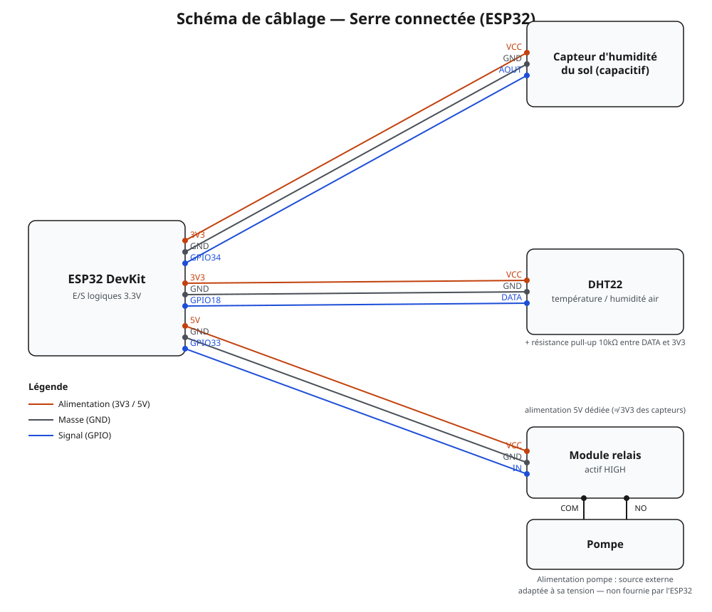

# Serre connectée — ESP32 (ESP-IDF)

Système d'irrigation automatique et connecté, écrit en C pur sur ESP32 avec le framework officiel Espressif (ESP-IDF, FreeRTOS natif). Le système surveille l'humidité du sol et la température/humidité de l'air, déclenche l'arrosage automatiquement, et publie les mesures en direct sur un broker MQTT, consultables depuis un dashboard web.

Projet réalisé pour démontrer des compétences en électronique embarquée : interfaçage capteurs/actionneurs, programmation bas niveau en C, structuration multitâche avec FreeRTOS, écriture d'un driver de protocole filaire propriétaire (DHT22), et connectivité IoT (WiFi + MQTT).

## Fonctionnalités

- Mesure de l'humidité du sol par capteur capacitif, calibrée sur deux points réels (air libre / immersion complète).
- Mesure de la température et de l'humidité de l'air via un capteur DHT22, piloté par un driver écrit à la main (protocole filaire à un seul fil, sans bibliothèque).
- Arrosage automatique via une pompe pilotée par relais, avec logique à hystérésis (deux seuils) pour éviter les activations répétées près du seuil.
- Firmware structuré en tâches FreeRTOS indépendantes communiquant par queues, plutôt qu'une boucle unique.
- Connectivité WiFi + MQTT : publication en direct des mesures sur un broker public (HiveMQ).
- Dashboard web de supervision en temps réel (humidité du sol, température, humidité de l'air), avec historique court (sparklines) et seuil d'arrosage réglable visuellement.

## Matériel utilisé

| Composant | Référence |
|---|---|
| Carte microcontrôleur | ESP32 DevKit (WiFi + Bluetooth, double cœur, USB-C) |
| Capteur d'humidité du sol | Capteur capacitif analogique |
| Capteur température / humidité air | DHT22 |
| Actionneur | Mini pompe à eau 5V/12V + module relais 1 canal |
| Alimentation | USB-C 20W (secteur) |

## Schéma de câblage



| Composant | Broche ESP32 | Alimentation |
|---|---|---|
| Capteur d'humidité du sol (AOUT) | GPIO34 (ADC1_CH6) | 3.3V |
| DHT22 (DATA) | GPIO18 (+ résistance pull-up 10kΩ vers 3.3V) | 3.3V |
| Module relais (IN) | GPIO33 | 5V (alimentation dédiée au module, distincte du 3.3V des capteurs) |
| Pompe | via les bornes COM / NO du relais | Source externe adaptée à sa tension (5V/12V selon le modèle) |

## Architecture logicielle

Le firmware est organisé en modules indépendants (`soil_sensor`, `pump`, `DHT`, `wifi`, `mqtt`), chacun avec son `.h`/`.c`, plutôt qu'un seul fichier monolithique.

| Tâche FreeRTOS | Rôle | Communication |
|---|---|---|
| `soil_sensor_task` | Lit l'ADC, calcule le pourcentage d'humidité, publie sur MQTT | Envoie sur `queue_moisture` |
| `pump_task` | Applique la logique d'hystérésis, pilote le relais | Bloquée sur `xQueueReceive(queue_moisture, portMAX_DELAY)` |
| `DHT_Task` | Lit le capteur DHT22 (handshake + 40 bits + checksum) | Envoie sur `queue_dht` |
| WiFi (événementiel) | Connexion station, gère la reconnexion | `esp_event_handler` + event group FreeRTOS, bloque `app_main` jusqu'à connexion |
| MQTT (`esp-mqtt`) | Connexion au broker, publication des topics `soil_moisture` et `dht_data` | Client gardé en variable `static` de fichier, exposé via `mqtt_publish_moisture()` / `mqtt_publish_dht()` |

Découpler les tâches par des queues FreeRTOS (plutôt que des variables globales partagées) évite les race conditions et garde chaque tâche testable indépendamment.

### Topics MQTT

| Topic | Contenu | Exemple |
|---|---|---|
| `soil_moisture` | Pourcentage d'humidité du sol (entier) | `42` |
| `dht_data` | Température et humidité de l'air (JSON) | `{"temperature": 25.70, "humidity": 52.40}` |

Broker utilisé : `broker.hivemq.com` (broker public, sans authentification — pratique pour le développement, à remplacer par un broker privé pour un déploiement réel).

## Dashboard de supervision

Le dashboard (`dashboard/dashboard-serre-connectee.html`) est une page web autonome qui se connecte en direct au broker MQTT via WebSocket sécurisé (`wss://broker.hivemq.com:8884/mqtt`) à l'aide de la bibliothèque `mqtt.js`, et affiche les trois mesures en temps réel.

C'est un fichier HTML/CSS/JS autonome, sans dépendance à un serveur : il suffit de l'ouvrir dans un navigateur.

## Mise en route

Prérequis : [ESP-IDF](https://docs.espressif.com/projects/esp-idf/en/latest/esp32/get-started/index.html) installé (v6.x), carte ESP32 connectée en USB.

```bash
# depuis la racine du projet (celle qui contient CMakeLists.txt et main/)
idf.py set-target esp32
idf.py build
idf.py -p <PORT> flash monitor
```

Le composant MQTT (`espressif/mqtt`) est résolu automatiquement au premier `idf.py build` via le gestionnaire de composants ESP-IDF (`main/idf_component.yml`).

Avant de flasher, renseigner son propre SSID/mot de passe WiFi dans `wifi.c` (ne pas committer de vrais identifiants dans un dépôt public).

## Compétences démontrées

- Programmation C embarquée bas niveau (pointeurs, gestion mémoire, types à taille fixe)
- FreeRTOS : tâches, queues, sections critiques
- Interfaçage capteur analogique (ADC) avec calibration réelle
- Écriture d'un driver de protocole filaire propriétaire à partir de zéro (DHT22), avec débogage de timing au microseconde
- Programmation événementielle (WiFi) vs. synchrone (capteurs)
- Protocole IoT MQTT, gestion des composants ESP-IDF


## État du projet

- [x] Prise en main ESP-IDF et GPIO
- [x] Capteur d'humidité du sol (ADC, calibration)
- [x] Relais + pompe (hystérésis)
- [x] Structuration FreeRTOS (tâches + queues)
- [x] Capteur DHT22 (driver maison)
- [x] WiFi + MQTT
- [x] Dashboard de supervision
- [ ] Boîtier et alimentation définitive
- [ ] Vidéo de démonstration

## Démo

*Photos du montage et vidéo de démonstration à venir.*


