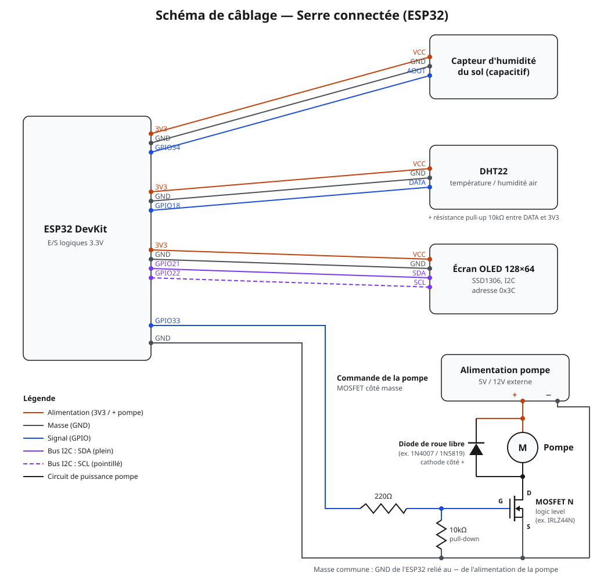

# Serre connectée — ESP32 (ESP-IDF)

Système d'irrigation automatique et connecté, écrit en C pur sur ESP32 avec le framework officiel Espressif (ESP-IDF, FreeRTOS natif). Le système surveille l'humidité du sol et la température/humidité de l'air, déclenche l'arrosage automatiquement, affiche l'état de la plante sur un écran OLED, et publie les mesures en direct sur un broker MQTT, consultables depuis un dashboard web.

Projet réalisé pour démontrer des compétences en électronique embarquée : interfaçage capteurs/actionneurs, programmation bas niveau en C, structuration multitâche avec FreeRTOS, écriture d'un driver de protocole filaire propriétaire (DHT22), intégration d'un écran OLED I2C, et connectivité IoT (WiFi + MQTT).

## Fonctionnalités

- Mesure de l'humidité du sol par capteur capacitif, calibrée sur deux points réels (air libre / immersion complète).
- Mesure de la température et de l'humidité de l'air via un capteur DHT22, piloté par un driver écrit à la main (protocole filaire à un seul fil, sans bibliothèque).
- Arrosage automatique via une pompe pilotée par un MOSFET canal N (avec diode de roue libre), avec logique à hystérésis (deux seuils) pour éviter les activations répétées près du seuil.
- Écran OLED I2C (SSD1306, 128×64) affichant la température et l'humidité du sol, avec un visage content si le sol est assez humide et un visage fâché s'il passe sous le seuil d'arrosage. Driver et rendu (police, lignes, cercles) sans bibliothèque graphique, réalisés avec l'aide de Claude (voir [Crédits](#crédits)).
- Firmware structuré en tâches FreeRTOS indépendantes communiquant par queues, plutôt qu'une boucle unique.
- Connectivité WiFi + MQTT : publication en direct des mesures sur un broker public (HiveMQ).
- Dashboard web de supervision en temps réel (humidité du sol, température, humidité de l'air), avec historique court (sparklines) et seuil d'arrosage réglable visuellement.

## Matériel utilisé

| Composant | Référence |
|---|---|
| Carte microcontrôleur | ESP32 DevKit (WiFi + Bluetooth, double cœur, USB-C) |
| Capteur d'humidité du sol | Capteur capacitif analogique |
| Capteur température / humidité air | DHT22 |
| Écran | OLED 0,96" 128×64, contrôleur SSD1306, interface I2C |
| Actionneur | Mini pompe à eau 5V/12V |
| Commande de la pompe | MOSFET canal N « logic level » (commandable en 3.3V) + diode de roue libre + résistances de grille et de pull-down |
| Alimentation | USB-C 20W (secteur) |

## Schéma de câblage



| Composant | Broche ESP32 | Alimentation |
|---|---|---|
| Capteur d'humidité du sol (AOUT) | GPIO34 (ADC1_CH6) | 3.3V |
| DHT22 (DATA) | GPIO18 (+ résistance pull-up 10kΩ vers 3.3V) | 3.3V |
| Écran OLED (SDA) | GPIO21 | 3.3V |
| Écran OLED (SCL) | GPIO22 | 3.3V |
| MOSFET (grille) | GPIO33, via une résistance série (~220Ω) + pull-down 10kΩ vers GND | — |
| Pompe | entre le + de l'alimentation de la pompe et le drain du MOSFET (source à GND) | Source externe adaptée à sa tension (5V/12V selon le modèle) |
| Diode de roue libre | en parallèle de la pompe, cathode côté +, anode côté drain | — |

Le MOSFET commute la pompe côté masse (low-side) : GPIO33 à l'état haut = pompe en marche. La pull-down maintient la pompe éteinte pendant le démarrage de l'ESP32, quand la broche est encore flottante. La diode absorbe le pic de tension inverse produit par le moteur de la pompe à chaque coupure, qui détruirait sinon le MOSFET. La masse de l'alimentation de la pompe doit être reliée à la masse de l'ESP32.

L'écran est à l'adresse I2C `0x3C` (certains modules utilisent `0x3D`, à changer dans `OLED_ADDR` de `main/oled.c`). Les modules OLED intègrent généralement leurs résistances de pull-up ; les pull-ups internes de l'ESP32 sont aussi activées.

## Architecture logicielle

Le firmware est organisé en modules indépendants (`soil_sensor`, `pump`, `DHT`, `i2c`, `oled`, `wifi`, `mqtt`), chacun avec son `.h`/`.c`, plutôt qu'un seul fichier monolithique.

| Tâche FreeRTOS | Rôle | Communication |
|---|---|---|
| `soil_sensor_task` | Lit l'ADC, calcule le pourcentage d'humidité, publie sur MQTT | Envoie sur `queue_moisture` |
| `pump_task` | Applique la logique d'hystérésis, commande le MOSFET de la pompe | Bloquée sur `xQueueReceive(queue_moisture, portMAX_DELAY)` |
| `DHT_Task` | Lit le capteur DHT22 (handshake + 40 bits + checksum) | Envoie sur `queue_dht` |
| `oled_task` | Redessine l'écran toutes les 500 ms (valeurs + visage) dans un framebuffer de 1 Ko, puis l'envoie en une seule transaction I2C | Lit les dernières valeurs fournies par `oled_set_soil()` / `oled_set_temperature()` |
| WiFi (événementiel) | Connexion station, gère la reconnexion | `esp_event_handler` + event group FreeRTOS, bloque `app_main` jusqu'à connexion |
| MQTT (`esp-mqtt`) | Connexion au broker, publication des topics `soil_moisture` et `dht_data` | Client gardé en variable `static` de fichier, exposé via `mqtt_publish_moisture()` / `mqtt_publish_dht()` |

Découpler les tâches par des queues FreeRTOS (plutôt que des variables globales partagées) évite les race conditions et garde chaque tâche testable indépendamment. Seul l'écran fait exception : il n'a besoin que de la dernière valeur de chaque mesure, pas de toutes les mesures. Les capteurs écrivent donc dans un état partagé du module `oled`, protégé par une section critique (`portMUX`), ce qui évite aussi de « voler » les messages de `queue_moisture` destinés à la pompe.

### Écran OLED

```
 Temp            .------.
 23.4°C         |  o  o  |
                |  \__/  |
 Soil            '------'
 45%
```

- À gauche : température (DHT22) et humidité du sol, en grands caractères. `--` s'affiche tant qu'aucune mesure n'est arrivée.
- À droite : visage **content** si l'humidité du sol est ≥ `THRESHOLD_L`, **fâché** (sourcils froncés, bouche tombante) en dessous.
- Le module `oled.c` (driver SSD1306 et dessin de l'écran) a été écrit avec Claude, l'assistant IA d'Anthropic, puis intégré au projet.
- Les seuils d'arrosage `THRESHOLD_L` (10 %, démarrage de la pompe) et `THRESHOLD_H` (25 %, arrêt) sont définis dans `main/pump.h` et partagés entre la pompe et l'écran : le visage devient fâché exactement quand la pompe se déclenche.

### Topics MQTT

| Topic | Contenu | Exemple |
|---|---|---|
| `soil_moisture` | Pourcentage d'humidité du sol (entier) | `42` |
| `dht_data` | Température et humidité de l'air (JSON) | `{"temperature": 25.70, "humidity": 52.40}` |

Broker utilisé : `broker.hivemq.com` (broker public, sans authentification — pratique pour le développement, à remplacer par un broker privé pour un déploiement réel).

## Dashboard de supervision

Le dashboard (`dashboard/dashboard-serre-connectee.html`) est une page web autonome qui se connecte en direct au broker MQTT via WebSocket sécurisé (`wss://broker.hivemq.com:8884/mqtt`) à l'aide de la bibliothèque `mqtt.js`, et affiche les trois mesures en temps réel.

C'est un fichier HTML/CSS/JS autonome, sans dépendance à un serveur : il suffit de l'ouvrir dans un navigateur.

## Mise en route

Prérequis : [ESP-IDF](https://docs.espressif.com/projects/esp-idf/en/latest/esp32/get-started/index.html) installé (v6.x), carte ESP32 connectée en USB.

```bash
# depuis la racine du projet (celle qui contient CMakeLists.txt et main/)
idf.py set-target esp32
idf.py build
idf.py -p <PORT> flash monitor
```

Le composant MQTT (`espressif/mqtt`) est résolu automatiquement au premier `idf.py build` via le gestionnaire de composants ESP-IDF (`main/idf_component.yml`).

Avant de flasher, renseigner son propre SSID/mot de passe WiFi dans `wifi.c` (ne pas committer de vrais identifiants dans un dépôt public).

## Compétences démontrées

- Programmation C embarquée bas niveau (pointeurs, gestion mémoire, types à taille fixe)
- FreeRTOS : tâches, queues, sections critiques
- Interfaçage capteur analogique (ADC) avec calibration réelle
- Écriture d'un driver de protocole filaire propriétaire à partir de zéro (DHT22), avec débogage de timing au microseconde
- Bus I2C (driver `i2c_master` d'ESP-IDF) et intégration d'un écran OLED SSD1306 dans l'architecture FreeRTOS
- Commande de puissance d'une charge inductive (pompe) par MOSFET, avec diode de roue libre
- Programmation événementielle (WiFi) vs. synchrone (capteurs)
- Protocole IoT MQTT, gestion des composants ESP-IDF


## État du projet

- [x] Prise en main ESP-IDF et GPIO
- [x] Capteur d'humidité du sol (ADC, calibration)
- [x] Pompe + logique d'hystérésis
- [x] Remplacement du relais par un MOSFET + diode de roue libre
- [x] Structuration FreeRTOS (tâches + queues)
- [x] Capteur DHT22 (driver maison)
- [x] WiFi + MQTT
- [x] Dashboard de supervision
- [x] Écran OLED I2C (mesures + visage selon l'humidité)
- [x] Schéma de câblage mis à jour (écran OLED, MOSFET + diode)
- [ ] Boîtier et alimentation définitive
- [ ] Vidéo de démonstration

## Crédits

Le module d'affichage `main/oled.c` (et `oled.h`) a été réalisé avec l'aide de [Claude](https://claude.ai), l'assistant IA d'Anthropic.

## Démo

*Photos du montage et vidéo de démonstration à venir.*


